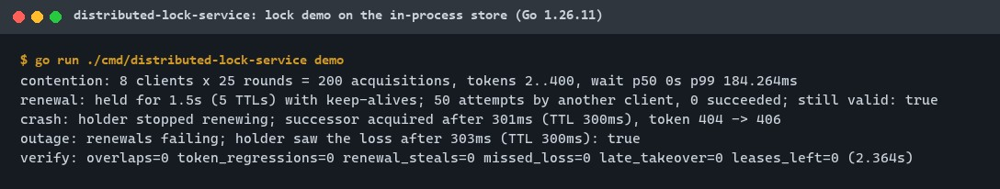
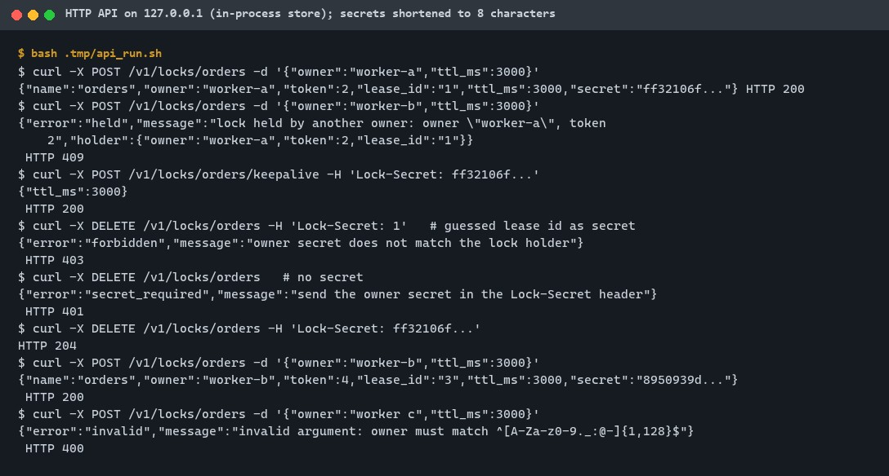
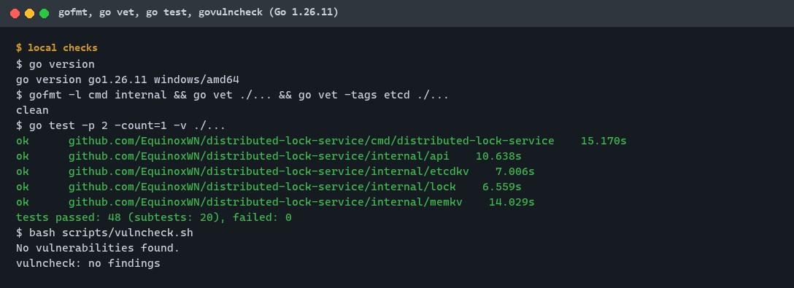
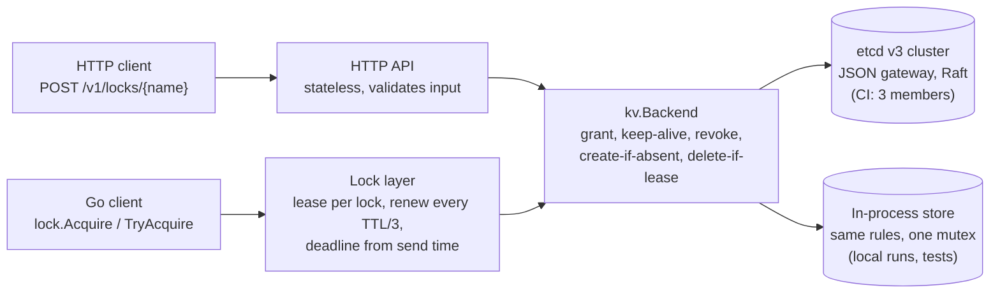
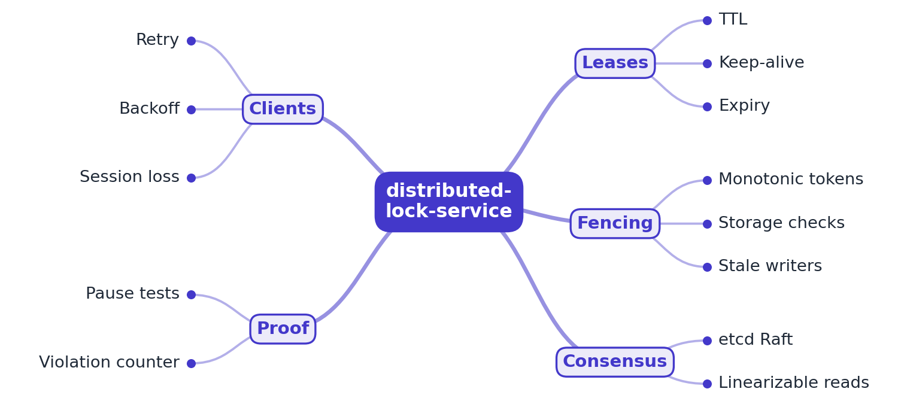

# distributed-lock-service

[](https://github.com/EquinoxWN/distributed-lock-service/actions/workflows/ci.yml)


> Two workers both think they hold the lock and corrupt data: a lease-based lock service with fencing tokens that stays safe through pauses and crashes.

Part of my **Distributed Systems & Storage** list · Go · core project

M1 is built: named locks held as leases with a time-to-live that the holder keeps renewing, stored
in etcd, and a fencing token with every acquisition that only ever increases. Each acquisition also
returns a random owner secret, required to renew or release the lock. It works as a Go library and as
an HTTP service. Locally everything runs on an in-process store with etcd's lease and
revision rules; the tests against a real three-member etcd cluster run only in CI and have not run
yet. Storage that rejects old tokens is M2.

## Proof it works

The demo on the in-process store: 8 clients take one lock 200 times (no overlap, tokens strictly
increasing), a renewing holder keeps its lock for 5 TTLs, a crashed holder's lock is taken over after
one TTL, and a holder whose renewals fail sees the loss by its deadline:



The HTTP API on 127.0.0.1 with curl: acquire (with its owner secret, shortened in the image), 409
with the holder, keep-alive with the secret, release refused with a guessed lease id (403) and with
no secret (401), release with the secret, re-acquire with a larger token, invalid owner 400:



gofmt and go vet are clean, 48 tests pass (plus 20 subtests), and govulncheck with Go 1.26.11
finds no vulnerabilities (see [Tests and results](#tests-and-results)):



## Architecture

**What M1 runs today:**



**Full roadmap (M1 to M3):**



## How it works

_Steps 1 and 2 are built and tested (M1); the rest is on the [roadmap](#roadmap)._

1. Clients acquire a lock as a lease with a time-to-live and must keep renewing it; state is stored in etcd for consensus.
2. Every acquisition returns a fencing token that only ever increases.
3. The protected storage rejects writes carrying an older token, so a paused client that wakes up can't corrupt data.
4. Tests freeze a client mid-write (simulating a long GC pause) while another client acquires the lock.
5. Partitions and clock jumps are injected to show the leases rely on consensus, not synchronized clocks.
6. A naive lock without fencing runs alongside to count the corruptions it allows.

In M1 terms:

- **A lock is a key on a lease.** `Acquire(name, owner, ttl)` grants a lease, starts renewing it, and
  creates `/dls/locks/<name>` on it in a transaction that succeeds only if the key does not exist.
  `TryAcquire` returns the current holder instead of waiting; `Acquire` retries with jittered backoff
  (10 to 250 ms) until the lock is free or its context ends.
- **Fencing token = the key's create revision** ([ADR 0002](docs/adr/0002-fencing-token-is-the-create-revision.md)).
  etcd raises one cluster-wide revision on every write, so a later acquisition always gets a larger
  token, for any lock name and any client.
- **Renewal.** A keep-alive goes out every TTL/3. The client's deadline is the send time of its last
  successful keep-alive plus the TTL, so it never believes it holds the lock longer than the store
  does. If renewals fail until that deadline, or the store says the lease is gone, the lock ends:
  `Done()` closes, `Err()` is `ErrLost`, `Valid()` is false.
- **Crash.** A holder that stops renewing loses the lock one TTL after its last renewal; the store
  deletes the key and the next waiter gets a larger token.
- **Owner secret** ([ADR 0004](docs/adr/0004-owner-secret-not-lease-id.md)). Each acquisition gets
  a random 256-bit secret from `crypto/rand`, returned once. The store keeps only its SHA-256 next to
  the owner. Renewing or releasing by name (`Client.KeepAlive`, `Client.Release`, or the HTTP API's
  `Lock-Secret` header) needs the secret, compared in constant time. A lease id, which is visible and
  guessable, is not accepted as proof. The secret is never logged.
- **Release** deletes the key only if the holder's lease still holds it, then revokes the lease; a
  holder whose lock already expired cannot delete its successor's lock (its secret no longer matches).
- **What M1 does not stop:** a holder paused longer than its TTL that wakes up and writes. It can
  find out (`Valid()`, `Done()`), and it carries an older token; storage that rejects that token is M2.

## Who it helps

- **Who:** Backend engineers running several workers or service instances against shared state (a job that must run once, one writer per shard), and anyone preparing the "design a distributed lock" interview question.
- **The problem:** A lock with a timeout frees itself when its holder pauses or crashes, but the old holder may still act; here every acquisition has a token that only increases, and the holder is told when its lease is gone instead of finding out later.
- **How to use it:** In Go, call `lock.New` with an etcd backend (`etcdkv.New`), then `Acquire`, pass `l.Token` with every write, watch `l.Done()`, and `Release`; from other languages run `serve -etcd ...`, keep the `secret` from the acquire answer, and send it in `Lock-Secret` to renew and release; run `make demo` to see the failure scenarios.

## Tech stack

| Area | In M1 | Planned |
|---|---|---|
| Core | Go 1.26 standard library only (ADR 0003); `kv.Backend` interface with a shared contract test | Watches for FIFO waiting instead of polling |
| Store | etcd v3 through its JSON gateway (`net/http`), timeouts, bounded retries, endpoint rotation; in-process store with etcd's rules for local runs | |
| Safety | Leases with TTL, keep-alive every TTL/3, conservative client deadline, monotonic fencing tokens, release only by the holding lease, random owner secret (stored hashed, compared in constant time) for renew and release | Storage that rejects older tokens (M2), TLS |
| API | Go library (`internal/lock`); HTTP: `POST`/`GET`/`DELETE /v1/locks/{name}`, `POST /v1/locks/{name}/keepalive` (both with `Lock-Secret`), `GET /healthz` | gRPC API |
| Test | Unit, backend contract (twice locally), concurrency, fault injection, HTTP, end-to-end demo, hand mutation testing; real etcd in CI | Simulated GC pauses, partitions, clock jumps, naive-lock comparison |
| CI | gofmt, go vet, `go test -race`, govulncheck, demo with a `::notice`; three-member etcd cluster with the integration tests | |

| Path | What it is |
|---|---|
| `cmd/distributed-lock-service` | CLI: `serve` (HTTP API) and `demo` (four scenarios with a verify line) |
| `internal/kv` | `Backend` interface, errors, key and value limits |
| `internal/kv/kvtest` | The contract every backend must pass (10 cases) |
| `internal/memkv` | In-process store: leases, revisions, expiry on an injected clock, fault hook for tests |
| `internal/etcdkv` | etcd v3 client over the JSON gateway; `etcd_integration_test.go` runs against real etcd (CI) |
| `internal/lock` | Acquire, renew, release, loss detection, fencing tokens; `secret.go`: owner secrets, renew and release by name |
| `internal/api` | HTTP handlers and error mapping |

## Run it

Prerequisites: Go 1.26 or newer (CI uses 1.26.11). No Docker is needed. For the etcd backend, an
etcd v3.5 or newer cluster with the gRPC gateway enabled (the default).

```bash
make setup      # go mod download (no third-party modules)
make lint       # gofmt and go vet (also with the etcd build tag)
make test       # all local tests with the race detector (needs cgo; without a C compiler use: go test ./...)
make audit      # govulncheck through scripts/vulncheck.sh
make demo       # the four scenarios behind the numbers below (same as make bench)
make serve      # API on 127.0.0.1:8080 with the in-process store (single instance)
go run ./cmd/distributed-lock-service serve -etcd http://127.0.0.1:2379,http://127.0.0.1:22379
make test-etcd  # integration tests; needs DLS_ETCD_ENDPOINTS (comma-separated etcd URLs)
```

Try the API (in a second terminal while `make serve` runs):

```bash
curl -H 'Content-Type: application/json' -X POST localhost:8080/v1/locks/orders \
  -d '{"owner":"worker-a","ttl_ms":10000}'          # {"token":2,"lease_id":"1",...,"secret":"<64 hex>"}
curl -X POST -H "Lock-Secret: $SECRET" localhost:8080/v1/locks/orders/keepalive   # about every ttl/3
curl -X DELETE -H "Lock-Secret: $SECRET" localhost:8080/v1/locks/orders
```

The secret is shown only in the acquire answer. A missing secret is 401, a wrong one 403. Keep it
out of logs and URLs.

Flags: `serve -addr -etcd`; `demo -clients -rounds -ttl`. The service reads no environment
variables; the integration test reads `DLS_ETCD_ENDPOINTS`.

## Tests and results

Latest local run (full detail in [docs/results/m1.md](docs/results/m1.md)): **48 passed (plus 20 subtests), 0 failed**.

| Test file | Tests | What it proves |
|---|---|---|
| `cmd/distributed-lock-service/main_test.go` | 3 | The demo runs end to end with every verify count at 0; 12 bad argument sets are refused; backend selection |
| `internal/api/api_test.go` | 8 | Acquire with a 64-hex secret, 409 with holder (no secret in it), keep-alive past the TTL, idempotent release, re-acquire with a larger token; release and keep-alive refused without the secret (401), with a wrong secret, another lock's secret or the guessed lease id (403), and the old lease-id route is gone; 20 acquisitions give 20 different secrets and none appears in the server log; expiry frees the lock; a stale holder cannot release or renew the new holder's lock; 13 bad requests are 400; store outage 503 without leaking internals; health check |
| `internal/etcdkv/etcdkv_test.go` | 11 | The backend contract through a fake JSON gateway; option validation; 5xx retried then success; gives up after N attempts; 4xx not retried; failover to the next endpoint; request timeout; caller cancel stops retries; 7 malformed answers rejected; TTL rounding; int64 decoding |
| `internal/lock/lock_test.go` | 15 | Holder reported and loser's lease revoked; tokens increase across names and clients; renewal holds past the TTL; crash takeover after about one TTL with a larger token; loss on failed renewals and on revoked lease; `Valid()` false past the deadline; short outage ridden out; 8x10 concurrent acquisitions with 0 overlaps; context cancel; stale release; lost create reply; store errors returned without leaked leases |
| `internal/lock/secret_test.go` | 5 | Grant, keep-alive and release by name with a 256-bit secret; empty, zero, one-bit-flipped, another lock's, guessed-lease-id, extended and oversized secrets all refused for release and keep-alive; the store holds only the SHA-256; 50 acquisitions give 50 different secrets; a lock key not written by this service is an error, not a holder |
| `internal/memkv/memkv_test.go` | 6 | The backend contract; expiry exactly at the deadline; revision bumps; input limits; cancelled context and injected faults; 64 concurrent creates, one winner |
| `internal/etcdkv/etcd_integration_test.go` | 4 | Against a real three-member etcd cluster: the contract, 6 clients over 3 members with 0 overlaps and increasing tokens, release and keep-alive refused without the owner secret, crash takeover. **CI only, not yet run** |

Quality check against the 10 engineering rules, with the mutation table (24 of 24 hand mutants killed: 2 by tests added for survivors, 9 written for the owner secret): [docs/quality/2026-11-01.md](docs/quality/2026-11-01.md).

Headline results from the demo on this machine (in-process store, TTL 300 ms, Go 1.26.11):

| Result | Value |
|---|---|
| Contention | 200 acquisitions by 8 clients: 0 overlaps, tokens 2 to 400 strictly increasing, wait p99 184.3 ms |
| Renewal | Held for 5 TTLs with keep-alives; 50 attempts by another client, 0 succeeded |
| Crash takeover | 301 ms after the holder stopped renewing (TTL 300 ms); token 404 to 406 |
| Loss detection | Holder saw `ErrLost` 303 ms after renewals started failing (TTL 300 ms) |
| Leases left | 0 |
| govulncheck (Go 1.26.11) | No vulnerabilities found; any finding fails `scripts/vulncheck.sh` |

Not run locally: the race detector (needs cgo) and the real-etcd integration tests (no etcd cluster
locally); both run in CI. CI has not run yet for this repository.

## Roadmap

**M1** (≈15 h)
- [x] Write `docs/rfc/0001-design.md`: problem, goals, non-goals, chosen design
- [x] Clients acquire a lock as a lease with a time-to-live and must keep renewing it; state is stored in etcd for consensus.
- [x] Every acquisition returns a fencing token that only ever increases.

**M2** (≈20 h)
- [ ] The protected storage rejects writes carrying an older token, so a paused client that wakes up can't corrupt data.
- [ ] Tests freeze a client mid-write (simulating a long GC pause) while another client acquires the lock.

**M3** (≈25 h)
- [ ] Partitions and clock jumps are injected to show the leases rely on consensus, not synchronized clocks.
- [ ] A naive lock without fencing runs alongside to count the corruptions it allows.
- [ ] Publish the proof below with real numbers

## Proof

What this repo must show before it counts as done:

- Violation counts for a naive lock vs the fenced lock under injected pauses and partitions.

| Result | Value |
|---|---|
| Naive vs fenced violation counts | Not measured yet (M3). Current M1 numbers: see [Tests and results](#tests-and-results). |

## Why it matters

- **Interview angle:** 'Design a distributed lock', and why most answers without fencing are wrong.
- **Upstream I'd like to contribute to:** etcd: its concurrency package and documentation.

## Design docs

- [RFC 0001: design](docs/rfc/0001-design.md)
- [ADR 0001: record architecture decisions](docs/adr/0001-record-architecture-decisions.md)
- [ADR 0002: the fencing token is the create revision](docs/adr/0002-fencing-token-is-the-create-revision.md)
- [ADR 0003: etcd JSON gateway with the standard library](docs/adr/0003-etcd-json-gateway-standard-library.md)
- [ADR 0004: a random owner secret, not the lease id, proves who holds a lock](docs/adr/0004-owner-secret-not-lease-id.md)
- [M1 results](docs/results/m1.md)
- [Quality check](docs/quality/2026-11-01.md)

## Scope

This is a learning and portfolio system, not a hosted production service. Locally everything runs
on the in-process store; real etcd runs only in CI.

Known limitations in M1: a holder paused longer than its TTL can still write until storage checks
tokens (M2); waiters poll with backoff, so there is no FIFO order; etcd counts TTLs in whole seconds
and raises very short ones to its minimum; the in-process store is a single process and loses state
on exit; the HTTP API has no caller authentication or TLS: any caller that can reach it can acquire a
free lock, and the owner secret is a bearer credential that must not leak (the service binds to
127.0.0.1 by default); the etcd client's
JSON shapes are verified locally only against a fake gateway until the CI job runs.

## Security and contributing

- Every GitHub Action is pinned to a commit SHA; the workflow runs read-only, without persisted credentials; the etcd release used in CI is checked against its SHA256SUMS.
- Dependabot update pull requests are paused (`open-pull-requests-limit: 0`) so the repository keeps a single `main` branch; dependencies are updated by hand and checked by the CI audit.
- Renew and release need the owner secret (256 random bits, stored as SHA-256, compared in constant time, never logged); a guessed or observed lease id gives no control over a lock.
- Untrusted input is bounded and validated: lock names, owners, TTLs, secrets, 4 KiB JSON bodies with no unknown fields, etcd endpoints and etcd answers (1 MiB limit); the server has read, write and idle timeouts.
- Report vulnerabilities privately: see [SECURITY.md](SECURITY.md). To contribute, see [CONTRIBUTING.md](CONTRIBUTING.md).

## License

MIT, see [LICENSE](LICENSE).
